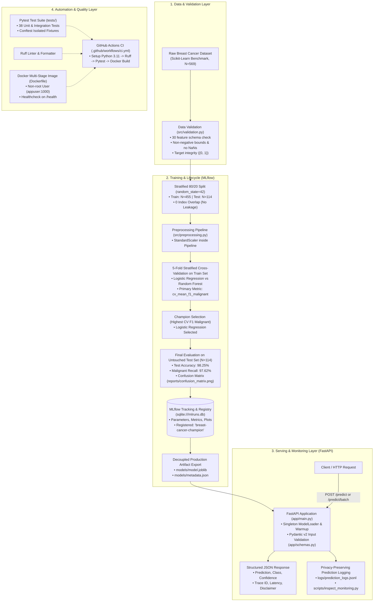
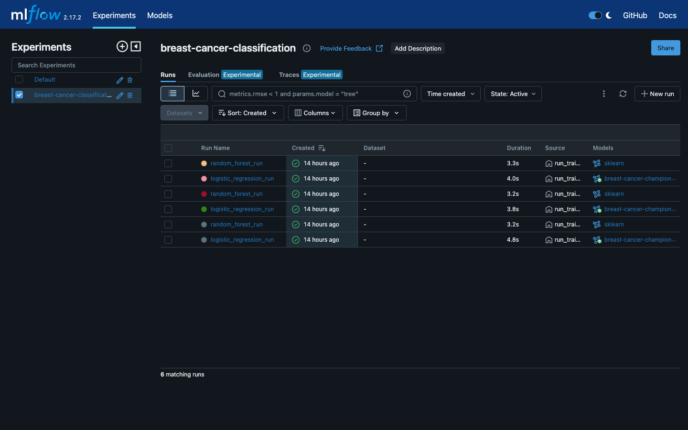
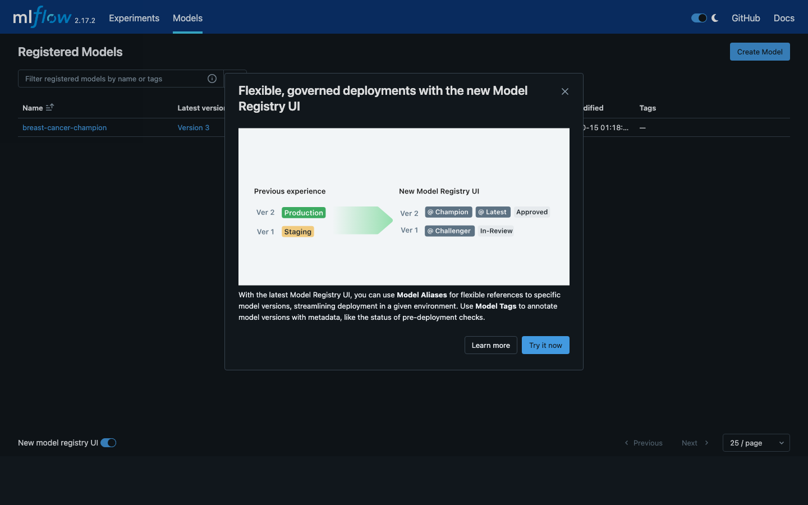
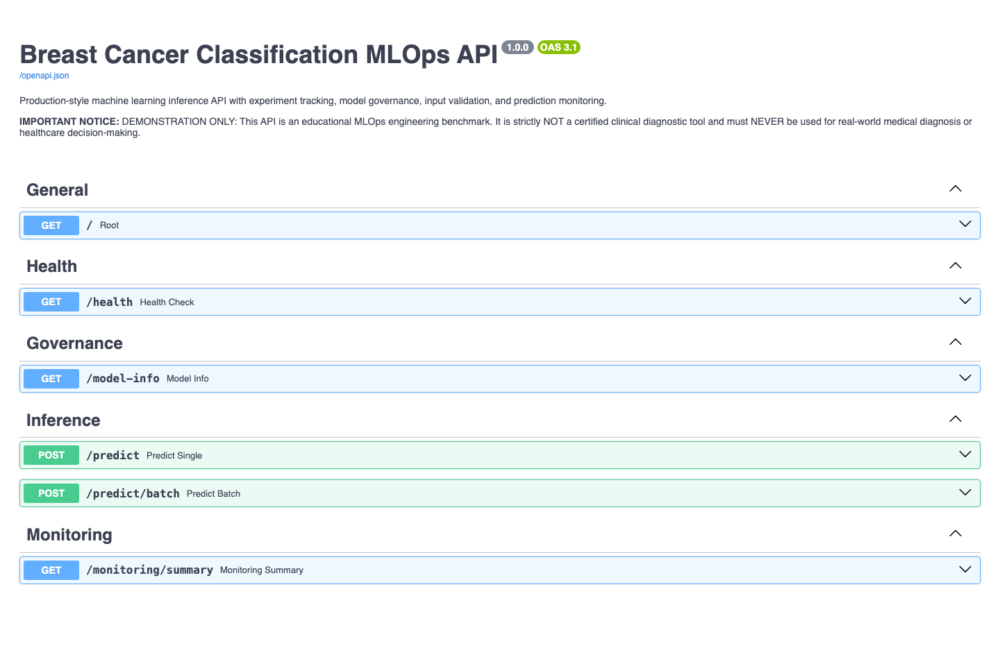
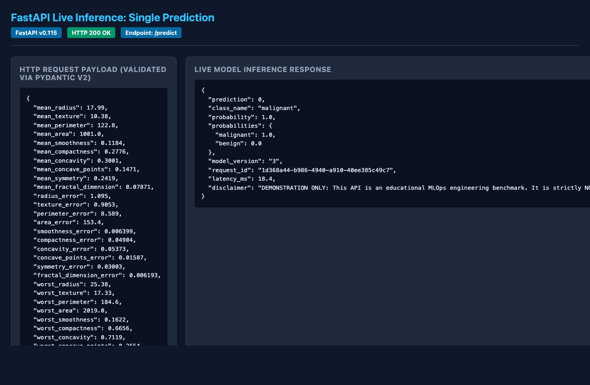
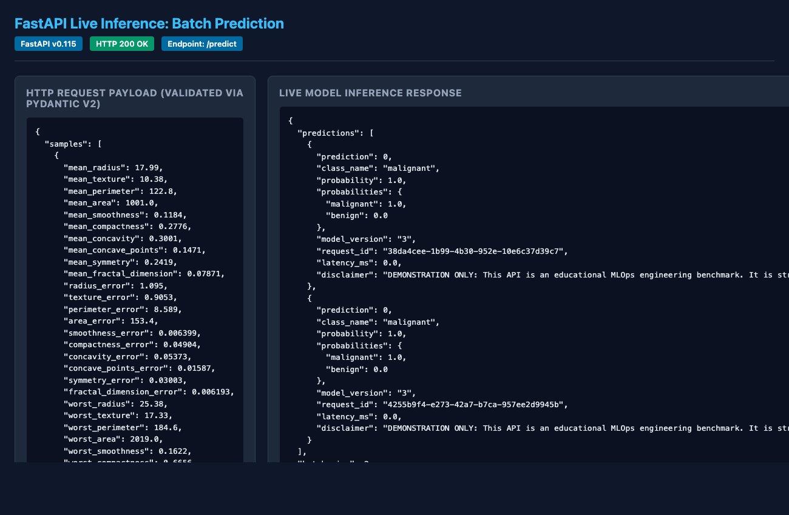
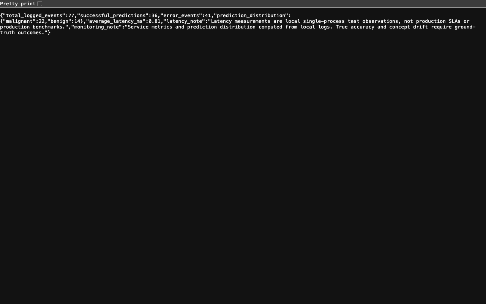

# End-to-End MLOps Pipeline: Experiment Tracking, Model Registry, Automated Deployment and Monitoring

[](https://www.python.org/)
[](https://fastapi.tiangolo.com/)
[](https://mlflow.org/)
[](https://scikit-learn.org/)
[](tests/)
[](https://github.com/astral-sh/ruff)
[](LICENSE)

An industry-grade, reproducible MLOps classification pipeline demonstrating the entire machine learning engineering lifecycle: data validation, data-leakage prevention, stratified cross-validation model selection, MLflow experiment tracking, a local SQLite-backed Model Registry, decoupled production artifact export, high-performance FastAPI serving with Pydantic v2 validation, automated testing (38 unit/integration tests), Docker containerization, GitHub Actions CI automation, and local privacy-conscious prediction monitoring.

---

> [!WARNING]
> **CRITICAL MEDICAL DISCLAIMER**
> This project uses the Breast Cancer Wisconsin (Diagnostic) benchmark dataset strictly as an **educational demonstration of software and MLOps engineering principles** (data validation, CI/CD, experiment tracking, model registry, containerization, and monitoring).
> 
> **THIS PIPELINE AND MODEL ARE NOT CLINICAL DIAGNOSTIC TOOLS AND MUST NEVER BE USED FOR REAL-WORLD MEDICAL DIAGNOSIS OR CLINICAL DECISION-MAKING.**

---

## Architecture Overview



---

## Technology Stack

| Category | Technology | Version | Purpose in Pipeline |
| :--- | :--- | :--- | :--- |
| **Language** | Python | `3.11.4` | Stable, high-performance base runtime for data science and web serving. |
| **Data Processing** | pandas, numpy | `2.3.3`, `1.26.4` | Tabular data manipulation, vectorization, and schema validation. |
| **Machine Learning**| scikit-learn, joblib | `1.5.2`, `1.4.2` | Data loading, `StandardScaler` pipeline, estimators, and serialization. |
| **Experiment Tracking**| MLflow, SQLAlchemy | `2.17.2`, `2.0.54` | Hyperparameter logging, metric tracking, and local SQLite Model Registry. |
| **Inference API** | FastAPI, Uvicorn | `0.115.14`, `0.31.1` | Asynchronous REST API serving with OpenAPI Swagger documentation. |
| **Validation** | Pydantic v2 | `2.14.1` | Runtime schema validation, numeric bounds, and forbidden extra fields. |
| **Testing** | Pytest, HTTPX | `8.4.2`, `0.28.1` | Automated unit and integration testing suite (38 tests). |
| **Code Quality** | Ruff | `0.7.4` | High-speed Rust-based code formatting and linting. |
| **Containerization**| Docker, Docker Compose | OCI Standard | Non-root container packaging and local multi-service orchestration. |
| **CI Automation** | GitHub Actions | Ubuntu Latest | Continuous integration workflow executing linting, testing, and container build. |

---

## Dataset Description & Clinical Diagnostic Mapping

- **Dataset:** Breast Cancer Wisconsin (Diagnostic) Dataset (`sklearn.datasets.load_breast_cancer`).
- **Samples:** 569 instances (357 benign, 212 malignant), 30 continuous numeric cell nucleus features.
- **Diagnostic Positive/Negative Convention:**
  - **Positive Class:** `0` = **Malignant** (the clinical condition of critical concern).
  - **Negative Class:** `1` = **Benign** (non-cancerous finding).

### Diagnostic Confusion Matrix Conventions

$$\begin{array}{c|c|c}
& \textbf{Predicted Malignant (0)} & \textbf{Predicted Benign (1)} \\
\hline
\textbf{True Malignant (0)} & \text{True Positive (TP) = 41} & \text{False Negative (FN) = 1 (Missed Tumor)} \\
\hline
\textbf{True Benign (1)} & \text{False Positive (FP) = 1 (False Alarm)} & \text{True Negative (TN) = 71} \\
\end{array}$$

- **Malignant Recall (Sensitivity):** $\frac{\text{TP}}{\text{TP} + \text{FN}} = \frac{41}{41 + 1} = \mathbf{97.62\%}$ (Only 1 malignant case missed).
- **Malignant Precision (PPV):** $\frac{\text{TP}}{\text{TP} + \text{FP}} = \frac{41}{41 + 1} = \mathbf{97.62\%}$.
- **Benign Specificity:** $\frac{\text{TN}}{\text{TN} + \text{FP}} = \frac{71}{71 + 1} = \mathbf{98.61\%}$.
- **Overall Accuracy:** $\frac{112}{114} = \mathbf{98.25\%}$.

---

## Machine Learning Lifecycle & Actual Measured Results

### 1. Leakage Prevention
To prevent test data leakage:
- Stratified 80/20 train/test split with `random_state=42` creates 455 training samples and 114 test samples. Index overlap is strictly verified to be **0**.
- `StandardScaler` is wrapped **inside** a scikit-learn `Pipeline`. Scaling parameters ($\mu, \sigma$) are computed **strictly on training partitions** and only applied to test sets via `transform()`.

### 2. 5-Fold Stratified Cross-Validation on Training Partition ($N=455$)

| Candidate Algorithm | Mean CV F1 (Malignant) | Mean CV Recall | Mean CV Accuracy | Mean CV ROC-AUC | Decision |
| :--- | :---: | :---: | :---: | :---: | :---: |
| **Logistic Regression (L2)** | **0.9703 ($\pm 0.0135$)** | **0.9647** | **0.9780** | **0.9959** | **SELECTED CHAMPION** |
| **Random Forest (100 trees)** | 0.9434 ($\pm 0.0255$) | 0.9353 | 0.9582 | 0.9892 | Baseline Runner-Up |

> **Champion Selection Rule:** The candidate with the highest 5-fold Stratified CV F1-score on the Malignant class on training data is selected. Logistic Regression outperformed Random Forest by $+0.0269$ F1 while demonstrating lower variance ($\pm 0.0135$ vs $\pm 0.0255$).

### 3. Generalization Performance on Untouched Test Set ($N=114$)

| Evaluation Metric | Champion: Logistic Regression | Runner-up: Random Forest |
| :--- | :---: | :---: |
| **Test Accuracy** | **98.25%** | 95.61% |
| **Test F1 (Malignant Class)** | **0.9762** | 0.9398 |
| **Test Recall (Malignant Class)** | **97.62%** | 92.86% |
| **Test Precision (Malignant Class)** | **97.62%** | 95.12% |
| **Test F1 (Macro)** | **0.9812** | 0.9526 |
| **Test ROC-AUC** | **0.9954** | 0.9934 |

---

## MLflow Tracking & Model Registry

Experiments are logged to a local SQLite database (`sqlite:///mlruns.db`), which natively supports both experiment tracking and the MLflow Model Registry locally without cloud dependencies.

### Launch MLflow Tracking UI
```bash
# Activate virtual environment
source .venv/bin/activate

# Launch MLflow UI backed by the SQLite database
mlflow ui --backend-store-uri sqlite:///mlruns.db --port 5000
```
Open [http://localhost:5000](http://localhost:5000) to inspect:
- Experiment `"breast-cancer-classification"` comparing all runs.
- Model Registry showing active versions of `"breast-cancer-champion"`.
- Logged evaluation artifacts: `reports/confusion_matrix.png`.

---

## FastAPI Inference Service

### Endpoints

| Method | Endpoint | Description |
| :--- | :--- | :--- |
| `GET` | `/` | Service information, version, and link to interactive documentation. |
| `GET` | `/health` | Health check and model readiness status (returns 200 healthy or 503 degraded). |
| `GET` | `/model-info` | Model governance metadata, active version, hyperparameters, and test metrics. |
| `POST`| `/predict` | Single prediction with Pydantic v2 validation (30 features). |
| `POST`| `/predict/batch`| Batch prediction with enforced array size bounds ($1 \le N \le 100$). |
| `GET` | `/monitoring/summary`| Summary statistics of logged predictions and service requests. |

### Example Request (`POST /predict`)
```json
{
  "mean_radius": 17.99,
  "mean_texture": 10.38,
  "mean_perimeter": 122.8,
  "mean_area": 1001.0,
  "mean_smoothness": 0.1184,
  "mean_compactness": 0.2776,
  "mean_concavity": 0.3001,
  "mean_concave_points": 0.1471,
  "mean_symmetry": 0.2419,
  "mean_fractal_dimension": 0.07871,
  "radius_error": 1.095,
  "texture_error": 0.9053,
  "perimeter_error": 8.589,
  "area_error": 153.4,
  "smoothness_error": 0.006399,
  "compactness_error": 0.04904,
  "concavity_error": 0.05373,
  "concave_points_error": 0.01587,
  "symmetry_error": 0.03003,
  "fractal_dimension_error": 0.006193,
  "worst_radius": 25.38,
  "worst_texture": 17.33,
  "worst_perimeter": 184.6,
  "worst_area": 2019.0,
  "worst_smoothness": 0.1622,
  "worst_compactness": 0.6656,
  "worst_concavity": 0.7119,
  "worst_concave_points": 0.2654,
  "worst_symmetry": 0.4601,
  "worst_fractal_dimension": 0.1189
}
```

### Example Response (`200 OK`)
```json
{
  "prediction": 0,
  "class_name": "malignant",
  "probability": 1.0,
  "probabilities": {
    "malignant": 1.0,
    "benign": 0.0
  },
  "model_version": "3",
  "request_id": "612bd437-010e-450f-a9b7-1c3df47e9081",
  "latency_ms": 0.45,
  "disclaimer": "DEMONSTRATION ONLY: This API is an educational MLOps engineering benchmark. It is strictly NOT a certified clinical diagnostic tool and must NEVER be used for real-world medical diagnosis or healthcare decision-making."
}
```

---

## Installation & Local Execution

### Prerequisites
- Python 3.11 (`python3.11 --version`)
- Git

### 1. Setup Virtual Environment
```bash
# Clone or navigate to the repository
cd mlops-classification-pipeline

# Create Python 3.11 virtual environment
python3.11 -m venv .venv

# Activate virtual environment
# On macOS / Linux:
source .venv/bin/activate
# On Windows:
# .venv\Scripts\activate

# Install pinned dependencies
pip install --upgrade pip
pip install -r requirements.txt
```

### 2. Retrain Model & Run Pipeline
```bash
python scripts/run_training.py
```

### 3. Verify Model Artifacts
```bash
python scripts/verify_model.py
```

### 4. Start the FastAPI Service
```bash
uvicorn app.main:app --host 0.0.0.0 --port 8000 --reload
```
Access interactive documentation:
- Swagger UI: [http://localhost:8000/docs](http://localhost:8000/docs)
- ReDoc: [http://localhost:8000/redoc](http://localhost:8000/redoc)

---

## Testing & Quality Assurance

The project enforces quality with Ruff and a 38-test automated Pytest suite:

```bash
# Run Ruff linting
ruff check .

# Run Ruff formatting check
ruff format --check .

# Run full test suite
pytest -v
```

---

## Docker Containerization

The service is packaged using a multi-stage, non-root container image (`python:3.11-slim`).

### Local Build & Run Commands
```bash
# Build the Docker image
docker build -t mlops-classification-pipeline:latest .

# Run container as a daemon
docker run -d --name mlops-api -p 8000:8000 mlops-classification-pipeline:latest

# Check container health status
docker inspect --format='{{json .State.Health.Status}}' mlops-api

# Test prediction via curl
curl -X POST http://localhost:8000/predict \
  -H "Content-Type: application/json" \
  -d @tests/sample_request.json

# Stop and remove container
docker stop mlops-api && docker rm mlops-api
```

### Local Docker Compose
```bash
# Start API with Docker Compose
docker-compose up -d

# View logs
docker-compose logs -f

# Shut down service
docker-compose down
```

---

## Continuous Integration (GitHub Actions)

The workflow defined in [`.github/workflows/ci.yml`](.github/workflows/ci.yml) triggers on every push and pull request to `main`:

```yaml
Jobs:
  1. lint-and-test:
     - Sets up Python 3.11 with pip caching.
     - Installs dependencies from requirements.txt.
     - Runs 'ruff check .' and 'ruff format --check .'.
     - Executes full 38-test suite via 'pytest -v'.
  2. docker-build:
     - Depends on lint-and-test passing.
     - Builds Docker image on Ubuntu runner.
     - Starts container, validates /health and /predict endpoints.
```
*Note: The workflow runs self-contained without requiring cloud credentials or secrets.*

---

## Prediction Logging & Privacy Monitoring

Local prediction monitoring records structured JSONL events to [`logs/prediction_logs.jsonl`](logs/prediction_logs.jsonl):
- **Privacy Design:** Excludes all sensitive raw inputs or unhashed personal identifiers. Summarizes feature vectors statistically (`mean`, `std`, `min`, `max`) to enable drift detection while protecting privacy.
- **Latency Disclaimer:** Latency figures in logs represent local single-process observations from test environments and are not production SLAs.
- **Inspect Monitoring Telemetry:**
  ```bash
  python scripts/inspect_monitoring.py
  ```

## Visual Demonstration & Screenshots

Authentic screenshots captured directly from the running local services:

### 1. MLflow Experiment Tracking & Run Comparison
Displays the experiment runs comparing Logistic Regression and Random Forest with their recorded parameters, cross-validation metrics, and test evaluation artifacts:


### 2. MLflow Model Registry
Displays the registered champion model (`breast-cancer-champion`) version governance in the SQLite backend:


### 3. FastAPI Interactive Swagger Documentation (`/docs`)
Displays OpenAPI specification, request schemas, validation rules, and the prominent medical demonstration notice:


### 4. Single Prediction Invocations (`POST /predict`)
Demonstrates validated input features, prediction outputs, probability distributions, latency, and trace ID:


### 5. Batch Prediction Invocations (`POST /predict/batch`)
Demonstrates multiple sample processing with batch-size bounds ($1 \le N \le 100$):


### 6. Local Prediction Monitoring Summary (`GET /monitoring/summary`)
Demonstrates real-time telemetry, observed prediction distribution across classes, and latency observations:


---

## Known Limitations & Troubleshooting

### 1. Docker Host Availability
- **Status:** The `Dockerfile`, `.dockerignore`, and `docker-compose.yml` are written to standard OCI specifications. If Docker Desktop is not installed on the local developer machine, local container build commands remain unverified locally.
- **Resolution:** The GitHub Actions CI workflow ([`.github/workflows/ci.yml`](.github/workflows/ci.yml)) automatically builds and tests the container on `ubuntu-latest` runners where Docker is natively installed.

### 2. SQLite Concurrency in MLflow
- **Status:** SQLite (`sqlite:///mlruns.db`) provides an ideal zero-dependency local backend supporting both experiment tracking and the native MLflow Model Registry. However, SQLite does not support high-concurrency distributed writes.
- **Resolution:** In distributed enterprise deployments, replace `sqlite:///mlruns.db` with a managed PostgreSQL or MySQL database URI (`postgresql://...`).

### 3. Model Monitoring vs. Ground Truth
- **Status:** The `/monitoring/summary` endpoint tracks request throughput, observed class distributions, and inference latency.
- **Resolution:** Statistical concept drift and true production accuracy cannot be calculated without delayed or verified ground-truth diagnostic labels. In production, this requires an asynchronous label ingestion pipeline.

---

## License

This project is licensed under the MIT License - see the [LICENSE](LICENSE) file for details.
